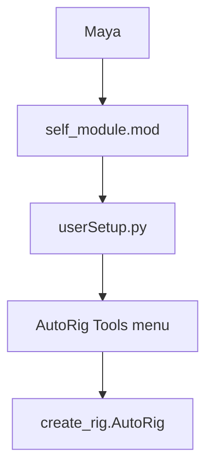

# Autorig Tools - Documentation index

> Entry point for Autorig Tools.
> Language: English (see `.cursor/rules/language.mdc`).
> Children: `maya_tools/`, `ue_tools/`, `modulos/`.

License: Apache-2.0 (`LICENSE`).

---

## Overview

Python (and a small C++ plugin) tools for character autorig in Autodesk
Maya, plus a Unreal Engine notes folder. Not a web app. Not a Docker
stack.

Run `scripts/install_maya_module.py` from the checkout Maya should use.
It writes `Documents/maya/modules/self_module.mod` with that checkout's
actual path and backs up a previous configuration. The legacy module
template can select an older clone when several checkouts exist.
On Maya start, `maya_tools/scripts/userSetup.py` builds the AutoRig Tools
menu, the AutoRig shelf, optional numpy, `proxy_locator`, and a localhost
MCP listener. Install steps: `README.md`.

Unreal: `ue_tools/` holds production notes and an empty `scripts/`
placeholder. There is no Unreal plugin in this repo yet.

Product vision: `modulos/vision/how_it_works.md`.
Maya UI criteria: `maya_tools/criterios-ui.md`.
Where a source is shown: `modulos/vision/mapa_datos.md`.
Parked for delivery: `modulos/vision/pendiente_final.md`.

```
autorig_tools/
|-- README.md
|-- LICENSE
|-- maya_tools/          Maya module, scripts, plugin, icons, cache
|-- ue_tools/            Unreal notes + empty scripts placeholder
|-- modulos/             Vision, data map, parked list
|-- .cursor/             Agent rules and skills index
```



---

## Which folder to read

### Read `maya_tools/how_it_works.md` if you need...
- Rig performance requirements and the Autorig/Edward optimization roadmap in
  `maya_tools/docs/rig_performance_plan.md`.
  Implemented behavior and accepted/rejected trials:
  `maya_tools/docs/rig_performance_results.md`.
- The dockable Tool Framework, shared red icons and explicit tool catalogue.
  Its Character context, read-only preflight, operation history, work profiles
  and guided per-character review checklist are implemented in Maya.
  Embedded Smooth/Transfer brushes release on tab changes and hide their
  viewport help banner; mouse instructions stay in the Skinning Manager.
  Menu and panel share Rigging subsections and the Deformers category.
  Architecture, current scope and phased implementation: `maya_tools/framework_plan.md`.
- Maya module path, scripts layout, autorig build, tools, plugin, MCP port.
- Jaw narrow with one shared projection NURBS and regulable corner controls;
  rounded-U corner falloff, center-weighted forward Auto Wide compensation and
  native lip/ribbon regressions are described in `maya_tools/how_it_works.md`.
- Build crash fixes, optional health audit, verified binary model cache and
  per-stage timings: `maya_tools/docs/build_performance_results.md`.
- Shared native UI hierarchy: semantic main-button colors, tool/tab icons,
  preserved vendor controls and live restyling through Reload UI. Asset switches
  retire obsolete version tabs and tolerate expired Qt style proxies.
- Model Checker: native results, 23 scoped automatic checks, guided visual
  review, vertex-set contact comparison, undoable repairs and JSON reports.
- Dockable Skinning Manager with native NG and its stacked skinCluster selector,
  brSmoothWeights, Ramp/Weights Server and a compact corrective blendshape tab.
- NG layer right-click Lips/Eyelid/Eyebrow Rigger actions use selected loops and
  the active skin's existing joints, preserve paired lip weights and start new
  facial masks black. L loops mirror to R and repeated runs reuse their layers.
- NG complete-loop lip/eye/brow skinning prototype: Lips contains Rotate and
  Non Rotate weight layers, mirrored commissures split upper00/lower00 50/50,
  and Nini's isolated review scene includes the complete corner loop and
  annotated cheek coverage with editable region masks. A separate real-rig
  review maps these layers to the production skin and tests animator controls.
- Biped spine control counts/spacing and IK/FK blending of deforming foot joints.
- Edward's native Maya 2024+ photo picker, installer and controller exports.
  Character Picker opens manually; CREATE RIG does not generate or embed it.
- Joint corrective targets, vertex masks and shoulder angle activation in Maya.
- Pose blendshapes with controller capture, preserved target names, pre/post
  sculpt editing and a Neutral pose button for all controls of the loaded rig.
- Optional native orientation correctives (Swing/Twist), mirror and `.skc`
  persistence, using base-rig joints independently of IK/FK control channels.
- Test Rig combination-pose geometry reports and build health diagnostics,
  with versioned comparisons and DG/Serial/Parallel measurements.
- Corrective sculpt transfer across topologies/LODs, with optional landmark
  registration, region masks and shared orientation drivers.
- Deformation-stack baking to skin, with separate fit/held-out poses,
  per-vertex error colors and rollback when an error limit is exceeded.
- Portable Bifrost wrinkle presets, editable vertex regions and local controls,
  with explicit projection across topologies and `.skc` provenance.
- Native combination correctives, continuous facial contact reports, local DQ
  comparisons and measured viewport detail modes in the existing editors.
- Hybrid skin/residual bake candidates and frozen rig packages with input hashes,
  two rebuild comparisons and native scene reopen before validation.
- General rig roles, configurable body/face/hand validation profiles, portable
  pose libraries, surface contact diagnostics and preflighted version migration
  in the existing Test Rig window. These workflows are character-independent.
- Skin `.skc` snapshots restore Pose Blendshapes SDKs and proximityWrap driver
  branches; see `maya_tools/how_it_works.md` for compatibility and validation.

### Read `maya_tools/criterios-ui.md` if you need...
- Menu, shelf, Qt windows. Do not invent a parallel Maya chrome.

### Read `ue_tools/how_it_works.md` if you need...
- Unreal notes and the empty scripts placeholder.

### Read `modulos/how_it_works.md` if you need...
- Vision, data map, parked list.

### Read `modulos/vision/how_it_works.md` if you need...
- Why the repo exists, who uses it. Do not invent a different product story.

### Read `modulos/vision/mapa_datos.md` if you need...
- Where guides, skin, curves, scenes must appear. Do not invent a window.

### Read `modulos/vision/pendiente_final.md` if you need...
- Items parked for delivery.

### Read `.cursor/skills/how_it_works.md` if you need...
- Which Cursor skill to open. None yet.

---

## Summary

| Folder | What it is |
|---|---|
| `maya_tools/` | Maya autorig, tools, UI, C++ collision plugin |
| `ue_tools/` | Unreal notes; scripts not built yet |
| `modulos/` | Operating model and maps for the agent |

Validation: Maya loads `self_module.mod` from `Documents/maya/modules`
or `MAYA_MODULE_PATH`, menu `AutoRig Tools` appears on the Maya menu bar,
shelf `AutoRig` appears. Live code and the `.mod` path are the source of
truth. Human install: `README.md`.
