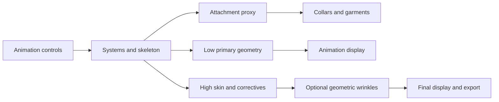

# Autorig and Edward performance requirements and change plan

Parent: `maya_tools/how_it_works.md`.
Scope: shared biped/quadruped systems, deformation, wrinkles and delivery.
Review date: 2026-10-14.

Current acceptance and priorities supersede older blanket GPU/cache statements:
`maya_tools/docs/rig_performance_criteria.md` and
`maya_tools/docs/rig_optimization_roadmap_20261015.md`.
This document retains the original research context and initial phase design.

Prioritize real evaluation bypass for Animation, independent garment drivers,
and reproducible measurement. Edward already uses matrix systems extensively;
replacing the remaining constraints or reducing mesh density is not the first
justified change. Preserve the authored deformation while testing each candidate.

## Evidence and limits

Research: Guido Gonzalez, *Arquitectures eficients de rigs per a l'animacio en
temps real*, 2026, supplied as 30137_an_2026 (1).pdf. References below use physical
PDF page numbers. Relevant sections: 3-5 (pp. 33-57), 7 (pp. 63-72), 10
(pp. 78-82), and measurement/audit annexes 12.1-12.6 (pp. 86-93).

The four measured rigs ran at 15.43-22.83 ms/frame in Parallel + GPU, with
96.1-100% of primary deformed vertices reported on GPU. Cached Playback ranged
from a 33% improvement to a 22% slowdown. The rig with 610 constraints had no
opaqueTaskEvaluation events in the recorded capture. These observations support
measuring GPU residency, critical-path work and cache effects before refactoring.
They do not establish Edward's speed, a universal cost for constraints/wraps,
or a universal prohibition on stacked skinClusters. The 16.4 ms intercept is
a two-point descriptive fit, not an irreducible Maya frame-time floor.

Official references used to qualify the implementation requirements:

- [Maya 2026 evaluator reference](https://help.autodesk.com/cloudhelp/2026/ENU/Maya-Customizing/files/GUID-27845E36-B873-42EB-B06F-9FE983E1080D.htm):
  invisibility pruning depends on downstream demand; animated visibility is
  considered visible. Frozen evaluation needs explicit configuration and care.
- [Maya 2026 deformerEvaluator](https://help.autodesk.com/cloudhelp/2026/ENU/Maya-Tech-Docs/CommandsPython/deformerEvaluator.html):
  query active chains, status and rejection messages, including download policy.
- [MPxNode scheduling](https://help.autodesk.com/cloudhelp/2026/ENU/MAYA-API-REF/cpp_ref/class_m_px_node.html):
  compiled nodes are not automatically Parallel. GloballySerial restricts other
  nodes with the same scheduling type; Untrusted has a broader exclusion scope.
- [Using Parallel Maya 2026](https://damassets.autodesk.net/content/dam/autodesk/www/html/using-parallel-maya/2026/UsingParallelMaya.html):
  validate dependencies and geometry before tuning; native graph evaluation and
  interactive manipulation have distinct behavior. Hidden getAttr dependencies
  are unsuitable for a correct evaluation graph.

## Confirmed Edward inventory

The saved `maya_tools/assets/Edward/scenes/Edward_working_v001.mb` was inspected
in a separate Maya standalone process without saving. Inventory is recorded in
`maya_tools/assets/Edward/validation/performance_static_20261014.json`.
Scene SHA-256: eaeef3f673df7676b8b34fc62bfabab600fdc5f78f77014fb948dde0ff13838e.
Maya reported version 2026, API 20260303; the paper used API 20260200.

- 16,886 scene nodes, 852 joints, 58 skinClusters, 9 blendShapes and 23
  proximityWrap nodes. These are scene-wide inventory, not active EG counts.
- 1,485 multMatrix nodes, 220 blendMatrix nodes, 202 parentMatrix nodes,
  106 motionPath nodes and 10 ikHandles. No parentConstraint, pointConstraint,
  aimConstraint or expression nodes were present. Two orientConstraints and
  four poleVectorConstraints remain. Wholesale constraint conversion has little
  obvious scope here; none of these counts proves a scheduling bottleneck.
- The head high has 11,475 vertices; head low has 3,082. The high head has
  eight skinCluster layers and one pose-corrective blendShape. The low head has
  four skinCluster layers and one pose-corrective blendShape.
- The high head's outMesh feeds `EdwardWrinklesGraphShape.AnimatedFace`.
  Its worldMesh feeds `collar2_PRX.drivers[1].driverGeometry` and
  `collar3_PRX.drivers[1].driverGeometry`. These are concrete downstream demands
  that must be considered before pruning the high head in Animation.
- The wrinkle graph has 153 internal Bifrost nodes, followed by
  `EdwardWrinkles_ToMaya` and a separate 11,475-vertex output mesh. Bifrost
  internal nodes are not individual Maya DG nodes. The saved wrinkle output was
  hidden, high source visible, and low head hidden; this is a saved state, not
  evidence that the hidden wrinkle graph evaluates during every frame.
- The portable preset contains 26 local controls and 27 full-length mask arrays:
  309,825 mask values, plus five region flow arrays and neighbor/rest arrays.
  This is dense stored data; it is not a measured memory or runtime bottleneck.
- Saved scene wrinkle Depth is 1.2 and CompressionStart is 0.0; the portable
  preset stores 0.5 and 0.015. Treat them as different authored versions.
  An optimization must not silently replace scene settings with preset defaults.
- Head skin layers already declare maxInfluences=5 with enforcement enabled.
  Eyelids and eyebrows use DQ. These settings do not prove the actual nonzero
  weight count at every vertex; measure weights before proposing any pruning.

Standalone cannot validate viewport FPS, interactive GPU residency or redraw
latency. It reported missing saved Node Editor UI types and stereoCamera metadata;
the process failed during Bifrost/Python shutdown after writing the inventory.
The scene was not saved. Use interactive Maya for final acceptance; the JSON is
structural evidence only. No measured Edward speedup is claimed here.

The workspace contains an outer checkout and a nested `autorig_tools` checkout
with existing differences. The inspected scene and performance/wrinkle backend
files match between them. This policy and plan are mirrored in both. Before
runtime changes, resolve Maya's installed module and imported __file__ paths;
modify and test the checkout it actually loads.

## Problems, effects and solutions

### 1. Detail modes currently change appearance without proving saved work

`maya_tools/scripts/tools/rig_performance.py:create_detail_modes` connects
conditions to high/low visibility and multiplies the wrinkle Envelope by the
high-mode value. This is useful output control, but there is no explicit wrinkle
compute bypass in `maya_tools/scripts/tools/bifrost_wrinkles.py:build`.
Envelope is a factor near the final displacement calculation, after compression,
smoothing and local-mask work. Multiplication by zero does not demonstrate that
those upstream calculations are skipped. Connected visibility also needs testing
against the evaluator's pruning rules.

Define an explicit contract:

- Animation: low/primary display output; independent low attachment drivers;
  expensive final-detail work unconsumed or explicitly disabled through a
  validated mechanism. Keep essential facial/contact deformation available.
- Review: final head and approved skin/correctives; geometric wrinkles can be
  enabled for facial review. This is where contacts must be judged on final shape.
- Final/Export: route the full-quality wrinkle result to display/export and enable
  required final layers. Current Review/Export use the same high-mode gate;
  implementing different evaluation contracts is proposed work.

Implement mode switches as explicit workflow transactions, with ownership,
rollback and restoration of prior settings. Avoid per-frame reconnection. A
candidate routing/frozen mechanism passes only if the Profiler shows absent
wrinkle/converter work in Animation and full, current output after re-enabling.
Ensure exactly one intended head output is shown/exported.

Also make `restore_detail_modes` idempotent: when detailMode already exists it
currently creates new wrinkle multiplyDivide nodes on restoration. Reuse the
owned gate or rebuild only missing owned connections. Repeated SKC/package
restores should retain node counts and connections rather than accumulating gates.

### 2. Garment consumers can keep hidden final head deformation alive

The two collar driver connections listed above can require `cabeza_high` even
when Animation displays `cabeza_low`. Hiding high geometry does not remove that
dependency. This is a dependency risk established by the saved scene; its runtime
cost and actual pruning behavior remain to be measured.

Create a small neck/head attachment proxy, or use a validated primary low head,
for collar driving in Animation. Transfer weights/rest driver data and verify
neck rotation, jaw motion, shoulder raise, global translation and scale. Retain
the original high driver in the final mode if the proxy cannot preserve contacts.
Audit all 23 proximityWrap nodes and their branches before generalizing this
change. Do not freeze shared high geometry while a visible garment still needs it.

### 3. Wrinkles traverse dense fields and a separate geometry conversion

The current graph computes four neighbor edge compressions per vertex, two
neighborhood smoothing passes, five region fields and local control masks.
It updates normals at the animated input and at the displaced output, then
converts the Bifrost geometry back into a Maya mesh. The high source is not
modified in place; a second displayed geometry is produced.

Possible effects are compression/mask CPU work, memory traffic, normal updates,
GPU read-back at the input, and mesh conversion/upload at the output. These are
profiling hypotheses, not proof that Bifrost disables GPU acceleration globally.
Inspect residency and timings on each side of the boundary.

Candidate changes, in increasing implementation cost:

1. Implement and verify the real Animation bypass first.
2. Precompute active vertex supports and shared region fields at build time;
   evaluate compact arrays and scatter displacements back to the unchanged full
   topology. Include neighbor/filter halos to preserve smoothing boundaries.
   Separate static data reduction from runtime work reduction in the report.
3. Reuse correct-stage normals if profiling shows duplication. The pre-wrinkle
   normal and post-wrinkle shading normal are different data; deleting one
   blindly can change wrinkle direction or shading.
4. Offer micro-wrinkles as shader normal/bump maps driven by existing activation.
   Keep folds that change silhouette, collision/contact geometry or export in
   the geometric branch. Judge shader variants under final lighting and UV seams.
5. For costly common expressions, prototype native tangent/post blendShape
   wrinkle shapes driven by existing poses. This approximates procedural
   compression; test unseen combinations, asymmetry and continuous transitions.
   Keep the editable procedural preset as the source of truth.
6. Cache final geometric detail after animation lock. Invalidate on animation,
   mesh/rest, mask, depth or code changes; record versions and frame range.
   A compiled/GPU deformer is a later option only if profiling justifies its
   implementation and deployment cost.

Test compression invariance under rigid transforms and scene/global scaling.
Current rest lengths and animated positions use object space; verify behavior
when nonuniform scale enters the deformation matrices. Check zero activation,
extreme compression, lip/eye safety masks, shading and reopen/round-trip output.

### 4. Existing measurements answer different questions

`rig_performance.benchmark` measures setAttr plus forced viewport refresh over
pose cases. It reports mean and p95, uses two repeats by default, and optionally
records Profiler during the timed workload. It does not run the paper's temporal
A/B/C/D protocol or isolate GPU execution.

`rig_validation.run_report` changes controls and reads all mesh points. Its
geometry comparisons are valuable, but the timed region includes CPU geometry
retrieval. Using that result as a GPU playback benchmark would mix validation
overhead and potentially forced downloads with production evaluation.

Extend the existing Test Rig backend with separate captures:

- Clean timing: body/facial timeline and control-interaction cases, median/p95/
  max, dispersion, at least three passes, warm-up and fixed viewport settings.
- Diagnostics: scheduling, Safe Mode/fallback, active GPU chains and rejection
  messages, node consumers, Profiler critical path and skipped work.
- Quality: the existing pose/transition geometry and contact checks, outside the
  timed loop. Avoid CPU vertex queries inside GPU performance samples.

Do not start a benchmark over an artist's unsaved animation. Use a versioned
trial scene and restore every changed state even when a capture fails.

### 5. Systems and skin need selective simplification

The matrix architecture is already established in
`maya_tools/scripts/utils/matrix_manager.py`; `fk_blend` reads FK controller
matrices without an intermediate FK joint. `surface_pin.py` can batch multiple
pins on one surface. Preserve these patterns where measurements support them.

Profile 106 motionPaths, 10 IK handles, repeated decompose/compose operations,
SDK/utility chains and facial curve/surface sampling. Counts identify candidates;
only critical-path time and controlled removal/replacement justify implementation.
Share calculations per space/surface and resolve static placement at build time.
Do not replace correct aim/orient/pole-vector behavior merely to remove a name
from the inventory.

For the eight high-head skin layers, measure stage cost and consumer requirements
before consolidation. Preserve DQ eyelid/eyebrow behavior, local bindPreMatrix
semantics and authored masks. Existing deformation_bake and hybrid_bake tools
provide a candidate route to skin plus residual shapes, using held-out poses
and rollback on error. Keep the layered authoring rig even if a delivery variant
uses a compact approximation. A single skin is not automatically faster/better.

Hair has 41,208 vertices in the saved scene. If VP2 dominates, test hair visibility,
simple shading, textures, shadows and smooth-preview settings separately. Reduce
geometry or material complexity only after the corresponding draw cost is shown.

### 6. Cache and simulation belong to a separate measured phase

Compare Cached Playback warm playback, cache fill, memory use and invalidation
after common edits. Enable it for a work profile only when it improves that
workflow. It cannot certify faster control manipulation or fix an expensive
upstream authoring graph.

Keep keepout/cloth/muscle/contact experiments outside the base Animation
evaluation unless needed by the shot. Cheap attachment/collision proxies feed
optional high-detail/CFX branches. Stateful simulation requires sequential
evaluation and a documented cache/reset contract. Bake validated output for
delivery; deterministic instantaneous wrinkles can be sampled differently from
stateful cloth, and the two must not share an unqualified reverse-playback test.

## Implementation sequence

Target dependency layout (a proposed change, subject to the Phase 2 gate):

The final detail branch must not feed its upstream skeleton or controls.
Animation bypass is accepted only when the high/detail branch is actually
skipped while the active proxy and garment branches remain correct.

### Phase 0 - Freeze the comparison inputs

Resolve active module/import paths. Preserve the saved scene, build, skin,
wrinkle preset and code hashes. Capture a final-quality pose/contact baseline
and choose the shot FPS. Reconcile scene/preset settings explicitly.
Output: versioned trial scene and immutable comparison manifest.
Gate: rebuild/import uses the intended checkout and no artistic data changes.

### Phase 1 - Make performance evidence reproducible

Extend `rig_performance.py` and reuse Test Rig rather than adding a new UI.
Implement clean A/B/C/D temporal timings plus independent interaction timings,
separate Profiler captures, scheduling and active-chain diagnostics. Exercise
jaw opening, blink, brows, smile, cheeks/nose, body/neck and mixed expressions.
Time identical Animation/Review/Final variants and use a representative shot too.
Output: timing JSON and diagnostic captures with top critical-path candidates.
Gate: at least three warm runs; visible deformation changes; complete channels;
quality capture excluded from timings. No performance claim from static inventory.

### Phase 2 - Remove unwanted Animation demand

Make detail restoration idempotent. Add explicit wrinkle-output ownership and
full-quality routing. Prototype the independent collar driver; then implement
real Animation bypass using the branch mechanism that passes interactive tests.
Output: same animation controls, lower active detail workload, clean restoration.
Gate: skipped heavy work demonstrated; collar contacts and mode switches correct;
node counts stable after repeated restoration; median/p95 improve beyond noise.

### Phase 3 - Optimize the largest remaining cost

Use Phase 1/2 captures to select one candidate at a time: compact wrinkle regions,
normal/conversion work, motionPath/matrix sharing, or a costly deformation layer.
Compare the procedural, pose-shape and shader/detail alternatives at matching
quality. Use deformation_bake/hybrid_bake only for layers shown to be costly.
Output: one measured replacement per version, with retained editable source.
Gate: geometry/contact/appearance requirements pass on held-out combinations;
no degradation of eyelids, lips, silhouette, IK/FK or scale behavior.

### Phase 4 - Choose cache and final/CFX delivery

Measure Cached Playback separately. Define detail/CFX cache hashes, invalidation,
topology and frame-range requirements. Package final geometry/skeleton/residual
data according to the destination's needs.
Output: measured work-profile cache choice and versioned delivery variant.
Gate: edits invalidate correctly; reopened results match; final export uses the
full-quality output and never silently exports the Animation proxy.

### Phase 5 - Enforce the policy in build and package validation

Store lightweight inventory/build health at build time. Keep interactive
benchmarks explicit; attach approved reports to `rig_package.py` manifests.
Run two rebuild comparisons, native scene reopen, SKC/wrinkle round-trip and
representative body/face transition/contact validation.
Output: accepted baseline for future regression checks.
Gate: no quality errors or regressions outside measurement noise; exceptions
identify their node, measured cost, purpose and reason for retention.

## Acceptance and rollback

- Animation playback p95 <= 1000 / shot FPS ms; 41.67 ms at 24 FPS. Prefer
  <=33.33 ms for headroom. Continue worthwhile optimization after meeting the
  minimum; no fixed speedup percentage is promised.
- Record interaction latency independently. Set its project budget from the
  measured animator workflow rather than reusing a playback FPS limit.
- Target >90% GPU residency for primary deformed vertices, with measured detail/
  CFX exceptions. Do not count procedural Bifrost output as static merely because
  its history has no geometryFilter node. Distinguish eligible, active and unknown.
- Require identical topology and default max vertex deviation <=1e-4 scene units
  for equivalent structural changes. For intentional approximate/LOD variants,
  declare separate geometric/contact/visual tolerances before fitting; use surface
  correspondences and final-camera review rather than a same-index comparison.
- Reject missing channels, stale re-enabled detail, contact loss, changed authored
  settings, incorrect mode export or improvements indistinguishable from noise.
- Preserve the original layered rig and all presets. Roll back a candidate by
  reopening its preceding version; never rebuild over the only approved scene.

Existing relevant tests to extend during implementation:
`maya_tools/scripts/tools/tests/test_rig_performance.py`,
`maya_tools/scripts/tools/tests/test_rig_validation.py`,
`maya_tools/scripts/tools/tests/test_bifrost_wrinkles.py`,
`maya_tools/scripts/tools/tests/test_wrinkle_skin_roundtrip.py`,
`maya_tools/scripts/tools/tests/test_hybrid_bake.py`, and
`maya_tools/scripts/tools/tests/test_rig_package.py`.
The current detail-mode test verifies visibility/envelope and unchanged geometry;
it does not yet verify skipped compute or restoration idempotency.

## Persistent rules

- `.cursor/rules/rig-performance-measurement.mdc`: benchmark and acceptance.
- `.cursor/rules/rig-evaluation-architecture.mdc`: graph and deformation design.
- `.cursor/rules/rig-wrinkles-and-detail.mdc`: wrinkle, LOD and simulation contracts.

These requirements apply to future changes. The implementation, measured gates,
accepted regional output and rejected cache/proxy trials are documented in
`maya_tools/docs/rig_performance_results.md`.
