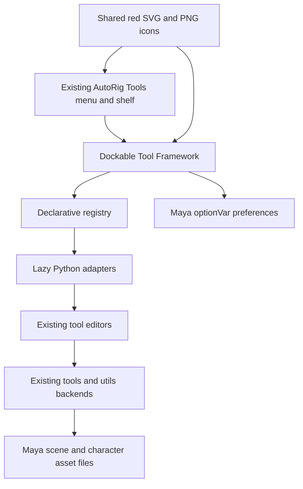

# AutoRig Tool Framework

Parent: `maya_tools/how_it_works.md`. UI: `maya_tools/criterios-ui.md`.
Scope: the installed checkout, native Autodesk Maya, existing rigging tools.
Date: 2026-10-14.

## Direction

Build a Python framework inside Maya around the current tool implementations.
The shared catalogue describes tools; a native dockable Qt panel lets a rigger
find and launch them. Keep each deformation algorithm and its existing file
workflow in its current module. Migrate editor widgets gradually.

The installed Maya module points to this nested checkout. The outer working
folder contains a second copy; new framework work belongs to the installed
checkout to avoid loading two different tool versions in the same session.

## Implemented foundation

- A native `workspaceControl` docked on the right, with Float / dock and a
  `uiScript` restoration entry point for saved Maya workspaces.
- 41 catalogue entries across Pipeline, Modeling, Rigging, Animation,
  Deformers and Simulation. Rigging contains Guides, Build, Controllers and
  Utilities. Deformers contains Skinning, Blendshapes, Correctives, Wrinkles,
  Wrap and Bake. The tree, category filters and menu use this hierarchy.
- Search by multiple words, category filters, persistent favorites and the
  last 12 launched tools in a versioned Maya `optionVar`.
- Descriptions and selection guidance beside the launch action.
- Lazy Python entry points: importing the catalogue does not load Maya, Qt,
  plug-ins or the rig-building modules. A requested action resolves its adapter.
- Original red icon set: 24 scalable SVGs and transparent 64px PNGs, shared
  by the framework, existing menu and shelf. Rebuild with
  `scripts/generate_framework_icons.py` using mayapy.
- Build actions ask to save before replacing the scene. Cancellation prevents
  dispatch. The incomplete legacy BUILD LEG action is listed with an explanation
  and cannot be run through the framework.
- Existing editors retain their current windows. The framework currently
  centralizes discovery and launching; it does not embed every editor.
- Character context pins the root, mesh and skinCluster by Maya UUID. It uses
  the existing rig role schema/message contract, rejects mixed characters and
  survives renaming/reparenting. Skinning, framework-launched Pose Blendshapes
  and Test Rig follow it; Picker receives the explicit root UUID. The existing
  asset selector and skin/corrective export paths use the chosen asset.
- Read-only preflight checks declared asset inputs, saved guide/build JSON,
  mesh/skin and selection requirements, and required plug-in availability.
  Opening an editor without context remains possible where it has its own
  input controls. Invalid actions show their reason before dispatch.
- Tools, Workflow and Activity tabs. Activity records opened, returned,
  completed, blocked, cancelled and failed outcomes, duration, context,
  warnings, explicit returned file paths and tracebacks. Logs live under the
  user's Maya app directory at `autorig/framework/operations.jsonl`; export
  the recent 200 records as JSON. A legacy action returning None is not
  reported as completed. Changes made later inside editors are not inferred
  from their initial launch record.
- All tools, Rigging, Deformers and Review work profiles remember filters,
  search, selected tool, expanded groups, framework tab and open Skinning/QA
  tab positions. Save layout saves explicitly; switching/hiding saves the
  current profile. Profiles do not silently switch the active character.
- Seven guided steps from Model Check to Rig Package, with explicit review
  marks and skip notes, isolated by root UUID (or asset when no scene root
  exists). A rebuilt rig has a new root UUID and a fresh review checklist.
  Opening a step marks it in progress; Next only navigates. Review
  marks are a personal checklist, not a substitute for actual QA reports.

Open through AutoRig Tools > Tool Framework or the first AutoRig shelf button:

```python
from maya_tools.scripts.ui import tool_framework_UI
tool_framework_UI.show()
```

## Architecture



`maya_tools/scripts/framework/registry.py` is the catalogue contract. Each
entry has a stable id, English label, category, section, icon, importable callable,
description, search keywords, optional arguments, scene replacement flag and
an optional unavailable reason. `tool_framework_UI.py` owns presentation and
preferences. It never evaluates command strings from files or scans and
executes arbitrary Python modules.

The menu and dockable catalogue generate their categories and sections from
the registry. Adding a registered tool updates both surfaces. The shelf keeps
its explicit shortcut list. Menu and framework build actions share the save
prompt before replacing the scene; unavailable entries are disabled in both.

## Existing capability coverage

- Pipeline: Character Manager and frozen validated rig packages.
- Modeling: Model Checker and its geometry checks.
- Rigging: reference, SELF and native-node leg build presets; guide creation,
  import/export/mirror and per-guide build; controller export/mirror; shape
  library; arc tracer, world bake, channel and rotation-order utilities;
  De Boor ribbons. BUILD LEG remains a disabled legacy entry.
- Animation and QA: character picker and Test Rig. Rig roles, configurable
  validation profiles, pose library, contact, migration and performance remain
  inside Test Rig rather than becoming duplicate editors.
- Correctives: joint targets, wrinkle regions, pose blendshapes, target
  transfer, import/export/mirror, corrective skin and split blendshapes.
- Skinning: the existing dockable Skinning Manager, NG/Smooth/Transfer/Ramp
  adapters, .skc workflows, proxy skinning, clothes transfer, proximity wrap,
  deformation/hybrid bake and De Boor curve/surface skin.
- Simulation: the existing AdonisFX weight-copy UI. AdonisFX is an optional
  external dependency; the catalogue does not bundle it.

Low-level solvers, rig modules and internal utilities remain Python APIs.
They need an explicit input contract before being exposed as artist actions.
The catalogue covers launchable workflows, not every Python function.

## Next implementation phases

### 1. Extend the implemented character context

`scripts/framework/context.py` now provides this service. Extend its adapters
to additional legacy editors rather than adding a second selection store.
The implemented integrations pin inputs explicitly; viewport clicks do not
choose another character automatically. Namespace and reference identities
use native UUIDs. Ambiguous instances require an explicit unambiguous node.

The framework debounces selection/Undo/Redo refresh only while visible and
resets context on scene changes. Hidden panels release their owned callbacks.
Finish a live sculpt before changing context. When selection is outside the
active mesh, NG is disabled and releases painting rather than changing target.

Acceptance: changing characters updates opted-in editors without mixing
meshes or influences from the previous character; closing the panel leaks no
callbacks. Namespaces and referenced characters must be covered.

### 2. Embed editors as opt-in pages

Extract reusable `QWidget` content from dialog shells. Define an adapter
contract such as `create_widget(parent, context)`, `refresh(context)` and
`dispose()`. Keep standalone `show()` entry points for existing callers.
Create only the active page and reuse it until explicitly closed.

The current Skinning Manager already has lazy pages and embedded pose
blendshapes; use that approach as the first integration example. Keep native
plug-in panels under adapters that own their paint contexts and callbacks.
Do not reparent live windows blindly or embed a second instance of an editor
with singleton state.

Acceptance: Skinning, Correctives and QA tabs work inside the shared workspace,
survive switching pages, restore safely and release tools on close. A missing
plug-in affects its page only and offers a clear retry.

### 3. Extend the implemented execution and preflight

`scripts/framework/execution.py` now handles menu/framework entry points,
input requirements and explicit outcomes. Extend coverage with each legacy
action's real input contract; add `undo_policy` only where supported.
Use undo chunks only for operations the existing Maya commands can undo;
file I/O, scene replacement and external plug-ins need their own handling.

The Activity panel provides results, duration and tracebacks. Scene actions
remain synchronous on Maya's main thread. For longer tasks, offload only
pure file/hash/numeric work that does not touch Maya API objects; report
progress through Qt signals. Cancellation is cooperative at safe steps.

Acceptance: failed preflight leaves scene, selection and tool context intact;
an action cancelled by its editor is not reported as completed.

### 4. Define repeatable workflows

The implemented Workflow tab opens one tool at a time and stores explicit
review marks per character. Extend it into versioned recipes with real
inputs and outputs. Start with Model Check -> Guides -> Build -> Skin -> Correctives ->
Validate -> Rig Package. Reuse `rig_profiles`, `rig_validation` and
`rig_package`; expose their existing results in the QA page.

Store recipe definitions with the asset, separate from user favorites.
Record input hashes, build settings, reports and tool versions. Validate
read-only steps before running mutations. Add optional before/after pose
comparisons and measured deformation errors, using the existing baseline
reports. Treat automatic fixes as individual reviewed actions.

Acceptance: the same frozen inputs produce comparable rebuild reports and
a package can be reopened and verified in a clean Maya process.

### 5. Make extensions and releases predictable

Add an explicit `register(Tool)` API with duplicate-id validation and a
schema/version contract. Load only configured extension modules. Add
dependency availability to the catalogue without importing every editor.
The menu and search catalogue already share definitions. Extend the metadata
with an opt-in shelf shortcut flag when shelf generation is needed.

Keep installed module paths portable through the existing installer. Test
with mayapy and the supported Maya/PySide combinations. Preserve character
data schemas and migrate sidecars explicitly. Unreal integration should
start from `tools/export_engine.py` and a defined export contract; this repo
currently ships Unreal notes, not an Unreal editor plug-in.

Acceptance: one registration adds a tool everywhere, a missing extension
does not stop startup, and the installation works from another checkout path.

## Suggested order

The context, preflight, journal, profiles and guided checklist are implemented.
Next embed more editors and extend action-specific contracts, followed by
versioned recipes and package validation. Finish
shelf generation and extension discovery after the metadata contract settles.
Keep the launcher useful during each migration.

## Verification

Run `maya_tools/scripts/tools/tests/test_tool_framework.py` with mayapy.
It covers adapter targets and arguments, workflow search, unavailable legacy
dispatch, malformed preferences, favorites, real editor launches and SKC
export, namespaces/stacked skins, context guards, profiles/reopen, journal
outcomes, workflow isolation, cancellation and a narrow native Qt layout.
`test_tool_framework_live.py` verifies native editor sharing, foreign-selection
protection, profiles, workflow isolation and callback cleanup in interactive
Maya. It checks the original skin weight digest and removes its test namespace.

Interactive validation also needs show/restore/float/dock/reopen, menu and
shelf icon loading, and a check that opening the panel leaves scene nodes,
selection and the modified flag unchanged. A full Maya restart and tests
of every deformation operation are separate from launcher verification.

Reference: Autodesk Maya 2026 `workspaceControl` documentation:
https://help.autodesk.com/cloudhelp/2026/ENU/Maya-Tech-Docs/CommandsPython/workspaceControl.html
